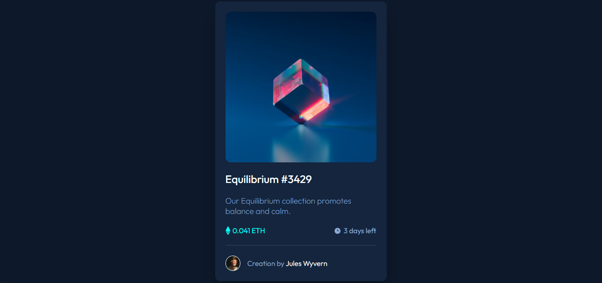

# Frontend Mentor -  nft-preview-card-component-main

## Table of contents

* [Overview](#overview)

  * [Screenshot](#screenshot)
  * [Links](#links)
* [My process](#my-process)
  * [Questions](#questions)
  * [Built with](#built-with)
* [Author](#author)
* [Code Documentation](#DocumentationCode)

## Overview

### Screenshot

### Links

* Solution URL: [link](https://github.com/Alex-Guar/frontend-mentor-challenges/tree/main/age-calculator-app-main/)
* Live Site URL: [link](https://alex-guar.github.io/frontend-mentor-challenges/age-calculator-app-main/)
* HTML: [link](./index.html)
* CSS: [link](./src/style.css)
* JS: [link](./src/main.js)

## My process

### Built with

* Semantic HTML5 markup
* CSS custom properties
* Flexboxh* Grid
* JS

The project is organised into different folders. The `src` folder contains the CSS styles and JavaScript files.

## Questions

### What are you most proud of, and what would you do differently next time?
On this occasion, I was able to work in a more organised way by using SMACSS. I liked the way this methodology helped me organise my CSS. In future projects, I would like to continue using SMACSS and improve how I organise my styles.

### What challenges did you encounter, and how did you overcome them?
I found problems with resposive design related with Image. For the moment, I used an div as wrapper, however I has some problemas.

### What specific areas of your project would you like help with?

* Frontend Mentor - [@yourusername](https://www.frontendmentor.io/profile/Alex-Guar)

