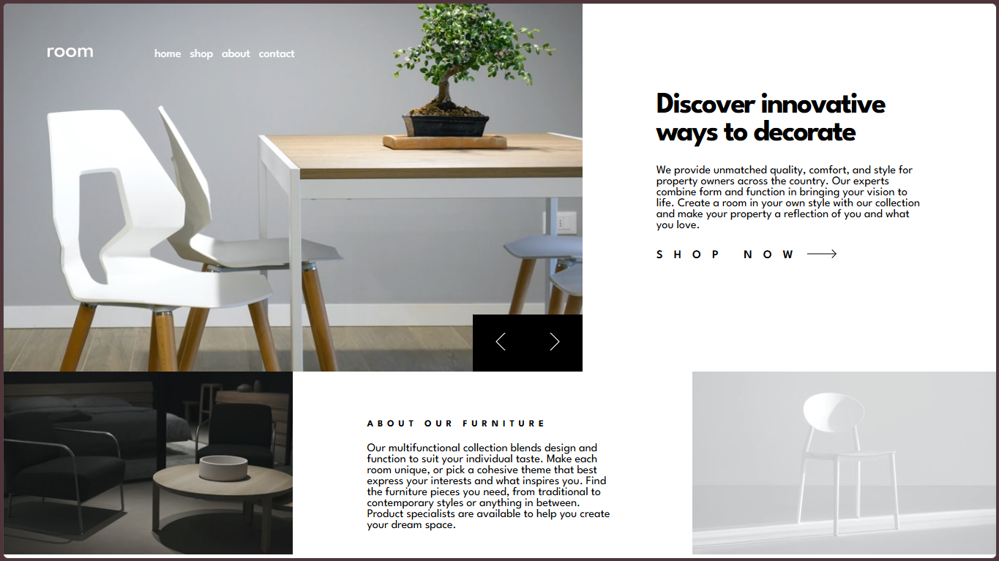

# Frontend Mentor -  room-homepage-master--
 Frontend Mentor challenges help you improve your coding skills by building realistic projects.

## Table of contents

* [Overview](#overview)

  * [Screenshot](#screenshot)
  * [Links](#links)
* [My process](#my-process)
  * [Questions](#questions)
  * [Built with](#built-with)
* [Author](#author)
* [Code Documentation](#DocumentationCode)

## Overview

### Screenshot

### Links

* Solution URL: [link](https://github.com/Alex-Guar/frontend-mentor-challenges/tree/main/room-homepage-master--/)
* Live Site URL: [link](https://alex-guar.github.io/frontend-mentor-challenges/room-homepage-master--/)
* HTML: [link](./index.html)
* CSS: [link](./src/style.css)
* JS: [link](./src/main.js)

## My process

### Built with

* Semantic HTML5 markup
* CSS custom properties
* Flexboxh* Grid
* JS

The project is organised into different folders. The `src` folder contains the CSS styles and JavaScript files.

## Questions

### What are you most proud of, and what would you do differently next time?
On this occasion, I was able to follow a mobile-first design approach. In the future, I would like to improve how I adapt my website to different screen sizes when implementing responsive design.

### What challenges did you encounter, and how did you overcome them?
I had some problems with the carousel. While working on it, I wanted to use scrolling without displaying the scrollbar. So, I found that the `scrollbar-width: none` property could help me achieve this.

Another aspect was disabling touch gestures on different products, so I used `touch-action: none`.

### What specific areas of your project would you like help with?
I would like to know whether `touch-action` is the best option for disabling touch-based scrolling on mobile devices.

* Frontend Mentor - [@yourusername](https://www.frontendmentor.io/profile/Alex-Guar)

