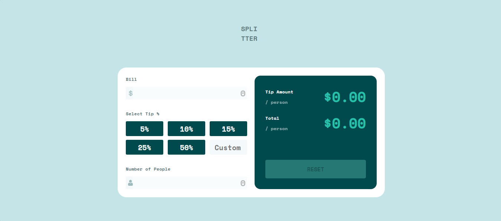

# Frontend Mentor -  tip-calculator-app
 Frontend Mentor challenges help you improve your coding skills by building realistic projects.

## Table of contents

* [Overview](#overview)

  * [Screenshot](#screenshot)
  * [Links](#links)
* [My process](#my-process)
  * [Questions](#questions)
  * [Built with](#built-with)
* [Author](#author)
* [Code Documentation](#DocumentationCode)

## Overview

### Screenshot

### Links

* Solution URL: [link](https://github.com/Alex-Guar/frontend-mentor-challenges/tree/main/tip-calculator-app/)
* Live Site URL: [link](https://alex-guar.github.io/frontend-mentor-challenges/tip-calculator-app/)
* HTML: [link](./index.html)
* CSS: [link](./src/style.css)
* JS: [link](./src/main.js)

## My process

### Built with

* Semantic HTML5 markup
* CSS custom properties
* Flexboxh* Grid
* JS

The project is organised into different folders. The `src` folder contains the CSS styles and JavaScript files.

## Questions

### What are you most proud of, and what would you do differently next time?

In other projects that I worked on, I used to define margins and padding for every part of an element. However, on this occasion, I decided to use `gap`. This allowed me to reduce the time I spent on the layout. Now, I think that in future projects, I want to improve my use of this feature.

### What challenges did you encounter, and how did you overcome them?

This project allowed me to enjoy programming. However, I found different challenges that I was able to solve.

Elements such as `input` allow users to enter text. However, I didn't know how to change the value so that it would return to the placeholder value.

In the documentation, I found that the DOM interface for an input element is `HTMLInputElement`. This interface has an instance property called `value`. So, I manipulated this property to clear the value and make the placeholder appear again.

### What specific areas of your project would you like help with?

**Class or Objects?**

I understand that JavaScript works with prototypes. So, a class in JavaScript is:

> "...syntax sugar over constructor functions..."
[score](https://developer.mozilla.org/en-US/docs/Web/JavaScript/Guide/Inheritance_and_the_prototype_chain#different_ways_of_creating_and_mutating_prototype_chains]
When should I use a class instead of a function?

* Frontend Mentor - [@yourusername](https://www.frontendmentor.io/profile/Alex-Guar)

# DocumentationCode

### Table of Contents

*   [isPositive][1]
    *   [Parameters][2]
*   [activateResetButton][3]
*   [desactivateResetButton][4]
*   [handleResestButtom][5]
*   [calculateTipAmoutPerson][6]
*   [renderTipAmountPerson][7]
*   [calculateTotalAmoutPerson][8]
*   [renderTotalAmoutPerson][9]
*   [Bill][10]
    *   [Parameters][11]
    *   [Properties][12]
    *   [renderErrorState][13]
    *   [clearErrorState][14]
    *   [addEventListener][15]
*   [Percentaje][16]
    *   [Parameters][17]
    *   [Properties][18]
    *   [renderErrorState][19]
    *   [clearErrorState][20]
    *   [renderColorSelection][21]
        *   [Parameters][22]
    *   [removeColorSelection][23]
    *   [removeInputTextCustom][24]
        *   [Parameters][25]
    *   [addEventListener][26]
*   [Person][27]
    *   [Parameters][28]
    *   [Properties][29]
    *   [renderErrorState][30]
    *   [clearErrorState][31]
    *   [addEventListener][32]

## isPositive

Evaluate if a value is a positive number.

### Parameters

*   `value` **[number][33]** Number to evaluate

Returns **[boolean][34]** True if positive, false otherwise

## activateResetButton

Show the reset button.

Returns **void**&#x20;

## desactivateResetButton

Hide/deactivate the reset button.

Returns **void**&#x20;

## handleResestButtom

Reset all input values and UI elements to initial state.

Returns **void**&#x20;

## calculateTipAmoutPerson

Determine and update the tip amount per person.

Returns **void**&#x20;

## renderTipAmountPerson

Update the tip amount value to display in HTML.

Returns **void**&#x20;

## calculateTotalAmoutPerson

Determine and update the total amount per person.

Returns **void**&#x20;

## renderTotalAmoutPerson

Update the total amount per person in HTML.

Returns **void**&#x20;

## Bill

Class representing an input element for the bill.

### Parameters

*   `idInput` **[string][35]** ID property of the HTML input
*   `idContainer` **[string][35]** ID property of the HTML parent of the input

### Properties

*   `value` **[number][33]** The value of the bill
*   `input` **[HTMLElement][36]** Represents the HTML input element
*   `container` **[HTMLElement][36]** Represents the parent element of the input

### renderErrorState

Activate the error border state.

Returns **void**&#x20;

### clearErrorState

Remove the error border state from the container.

Returns **void**&#x20;

### addEventListener

Register the input event listener for the bill element.

Returns **void**&#x20;

## Percentaje

Class representing the percentage input selection.

### Parameters

*   `className` &#x20;
*   `idCustom` &#x20;

### Properties

*   `value` **[number][33]** The value of the percentage
*   `className` **[string][35]** Class name of the percentage buttons
*   `idCustom` **[string][35]** ID of the custom percentage input
*   `percentajesArray` **[Array][37]<[HTMLElement][36]>** Array of percentage button elements

### renderErrorState

Activate the error state for the custom percentage input.

Returns **void**&#x20;

### clearErrorState

Remove the error state from the custom percentage input.

Returns **void**&#x20;

### renderColorSelection

Activate the selected color style on a percentage button.

#### Parameters

*   `idPercentage` **[string][35]** ID of the percentage element

Returns **void**&#x20;

### removeColorSelection

Remove the selected color style from all percentage buttons.

Returns **void**&#x20;

### removeInputTextCustom

Clear the value inside the custom percentage input.

#### Parameters

*   `idCustomPercentaje` **[string][35]** ID of the custom percentage input

Returns **void**&#x20;

### addEventListener

Register click event listeners for percentage buttons and input event listener for custom percentage.

Returns **void**&#x20;

## Person

Class representing the number of people input.

### Parameters

*   `idContainer` &#x20;
*   `idInput` &#x20;

### Properties

*   `idContainer` **[string][35]** ID of the HTML container
*   `idInput` **[string][35]** ID of the HTML input
*   `value` **[number][33]** Number of people to split the bill
*   `container` **[HTMLElement][36]** Parent element of the input
*   `input` **[HTMLElement][36]** HTML input element
*   `headError` **[HTMLElement][36]** Paragraph element for error messages

### renderErrorState

Display the error state and message to the user.

Returns **void**&#x20;

### clearErrorState

Clear the error state and hide the error message.

Returns **void**&#x20;

### addEventListener

Register the input event listener for the number of people element.

Returns **void**&#x20;

[1]: #ispositive

[2]: #parameters

[3]: #activateresetbutton

[4]: #desactivateresetbutton

[5]: #handleresestbuttom

[6]: #calculatetipamoutperson

[7]: #rendertipamountperson

[8]: #calculatetotalamoutperson

[9]: #rendertotalamoutperson

[10]: #bill

[11]: #parameters-1

[12]: #properties

[13]: #rendererrorstate

[14]: #clearerrorstate

[15]: #addeventlistener

[16]: #percentaje

[17]: #parameters-2

[18]: #properties-1

[19]: #rendererrorstate-1

[20]: #clearerrorstate-1

[21]: #rendercolorselection

[22]: #parameters-3

[23]: #removecolorselection

[24]: #removeinputtextcustom

[25]: #parameters-4

[26]: #addeventlistener-1

[27]: #person

[28]: #parameters-5

[29]: #properties-2

[30]: #rendererrorstate-2

[31]: #clearerrorstate-2

[32]: #addeventlistener-2

[33]: https://developer.mozilla.org/docs/Web/JavaScript/Reference/Global_Objects/Number

[34]: https://developer.mozilla.org/docs/Web/JavaScript/Reference/Global_Objects/Boolean

[35]: https://developer.mozilla.org/docs/Web/JavaScript/Reference/Global_Objects/String

[36]: https://developer.mozilla.org/docs/Web/HTML/Element

[37]: https://developer.mozilla.org/docs/Web/JavaScript/Reference/Global_Objects/Array
PS C:\Users\Jessica\Documents\Alexander\Programación\FrontMentor\tip-calculator-app\src>
